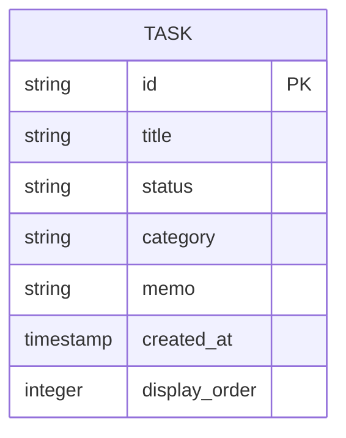

# データベース設計

## 概要

PostgreSQL を使用してデータを永続化する。
Docker で PostgreSQL を起動し、Spring Boot（JPA/Hibernate）経由でアクセスする。

## 環境

| 項目 | 内容 |
|------|------|
| DB | PostgreSQL 16 |
| 起動方法 | Docker（docker compose up -d） |
| ホスト | localhost:5432 |
| DB名 | taskmanagement |
| ユーザー | postgres |

## テーブル定義

### tasks テーブル

| カラム名 | 型 | NULL | 説明 |
|----------|-----|------|------|
| id | VARCHAR(36) | NOT NULL | 一意のID（UUID、自動生成） |
| title | VARCHAR(255) | NOT NULL | タスク名 |
| status | VARCHAR(255) | NOT NULL | "todo" / "doing" / "done" |
| category | VARCHAR(255) | 許可 | カテゴリ名（自由入力、空欄可） |
| memo | TEXT | 許可 | 補足メモ（空欄可） |
| created_at | TIMESTAMP | NOT NULL | 作成日時（自動） |
| display_order | INTEGER | NOT NULL | 表示順（デフォルト: 0） |

## ER図

