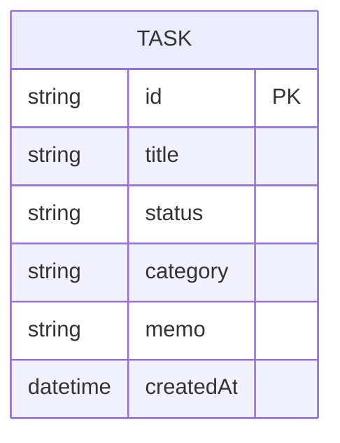

# データベース設計

## 概要

ブラウザの localStorage を使用してデータを永続化する。
サーバー・DBサーバーは使用しない。

## データ定義

### Task オブジェクト

| 項目名 | 型 | 説明 |
|--------|-----|------|
| id | 文字列 | 一意のID（自動生成） |
| title | 文字列 | タスク名 |
| status | 文字列 | "todo" / "doing" / "done" |
| category | 文字列 | カテゴリ名（自由入力、空欄可） |
| memo | 文字列 | 補足メモ（空欄可） |
| createdAt | 日時 | 作成日時（自動） |

## ER図

## ストレージ仕様

| 項目 | 内容 |
|------|------|
| 保存先 | localStorage |
| キー名 | tasks |
| 形式 | JSON配列（Task[]） |
| 想定データ量 | 最大70件程度（1日10件×7日） |
