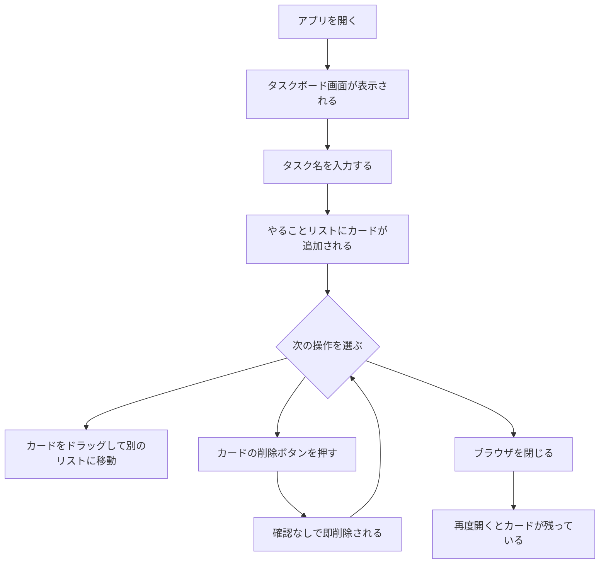

# 画面設計

## 画面一覧

| 画面名 | 説明 | 備考 |
|--------|------|------|
| タスクボード画面 | メイン画面。全操作をここで行う | 唯一の画面 |

将来候補（スコープ外）：タスク詳細画面・設定画面

## 操作フロー

## 画面要件

### タスクボード画面

- 3列のリスト（やること / やってる最中 / 完了）を横並びで表示
- 入力フォームでタスク名を入力してカードを追加できる
- 各カードはドラッグ＆ドロップで別リストに移動できる
- 各カードに削除ボタンがある（確認ダイアログなし）
- データはlocalStorageに保存され、再読み込み後も残る
