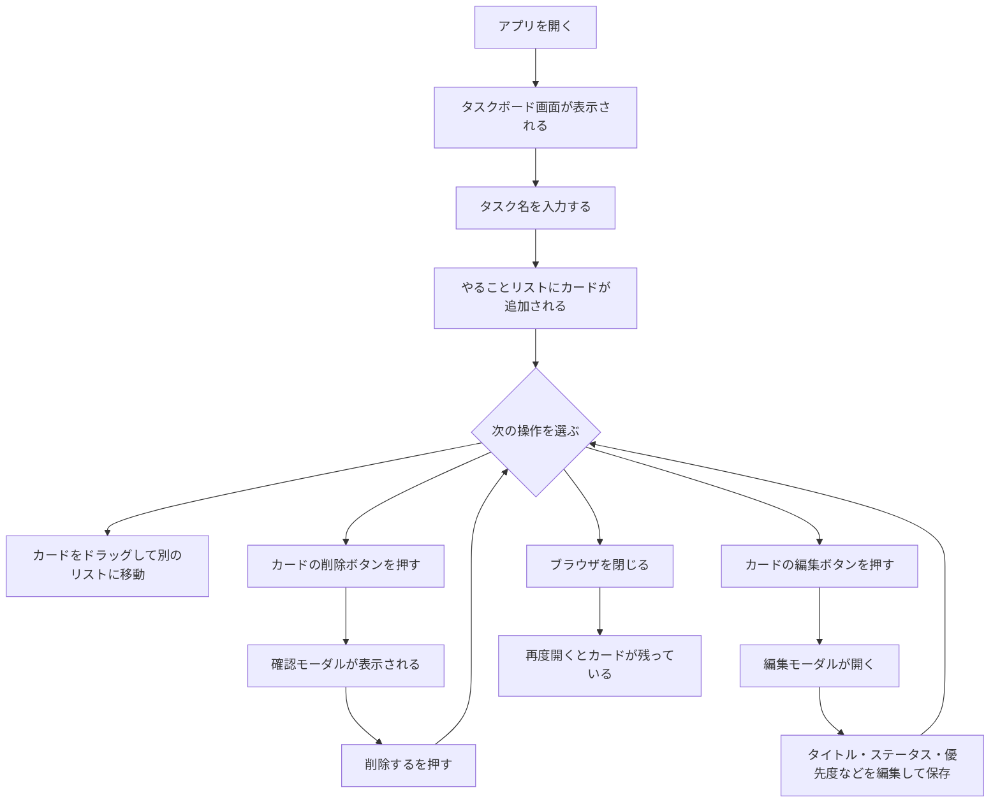

# 画面設計

## 画面一覧

| 画面名 | 説明 | 備考 |
|--------|------|------|
| タスクボード画面 | メイン画面。全操作をここで行う | 唯一の画面 |

将来候補（スコープ外）：タスク詳細画面・設定画面

## 操作フロー

## 画面要件

### タスクボード画面

- 3列のリスト（やること / やってる最中 / 完了）を横並びで表示
- 640px 以下の画面では3列を縦並びに切り替える（レスポンシブ対応）
- ヘッダーの入力フォームでタスク名を入力してカードを追加できる
- 各カードはドラッグ＆ドロップで別リストに移動できる（タッチ操作対応）
- 各カードに編集ボタン（✎）と削除ボタン（×）がある
- 削除ボタンを押すと確認モーダルが表示される
- 編集ボタンを押すと編集モーダルが開く
- データはサーバー（PostgreSQL）に保存され、再読み込み後も残る

### 編集モーダル

- タイトル（必須）・ステータス・優先度・期限日・カテゴリ・メモを編集できる
- Escape キーまたはオーバーレイクリックで閉じる

### 削除確認モーダル

- 削除対象のタスク名を表示して確認を求める
- 「削除する」ボタンで削除実行、「キャンセル」で閉じる
- Escape キーまたはオーバーレイクリックでキャンセル
