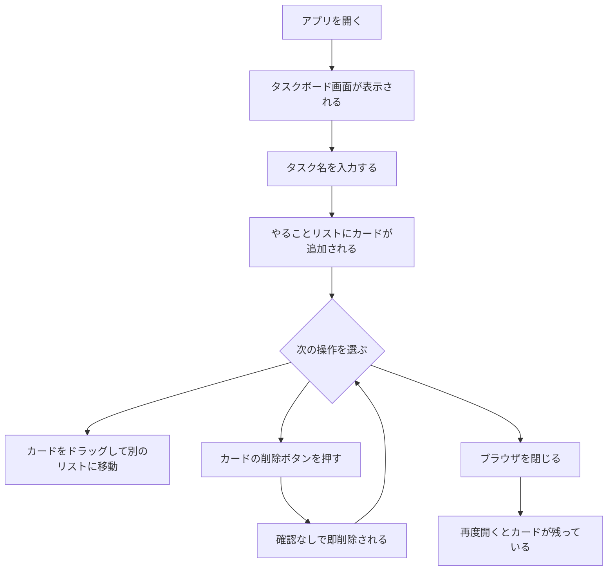

# 要件定義書

## 背景・目的

個人のタスク管理アプリを自作することで、Web開発の基礎（HTML/CSS/JavaScript）を学習する。

## 誰が使うか

自分だけ（ログイン不要）

## 何のために使うか

タスクを「やること / やってる最中 / 完了」で管理したい

---

## 機能一覧

| 機能 | 説明 |
|------|------|
| カードを作る | タスク名を入力して追加できる |
| リストを3つ表示 | 「やること」「やってる最中」「完了」 |
| カードを移動 | リスト間でカードを動かせる |
| カードを削除 | 不要なカードを即削除できる（確認なし） |

---

## 画面一覧

| 画面名 | 説明 | 備考 |
|--------|------|------|
| タスクボード画面 | メイン画面。全操作をここで行う | 唯一の画面 |

将来候補（スコープ外）：タスク詳細画面・設定画面

---

## 操作フロー

---

## ユースケース

アクター：ユーザー（自分）

- タスクを追加する
- タスクをステータス移動する
- タスクを削除する
- タスク一覧を確認する

---

## 非機能要件

| 項目 | 内容 |
|------|------|
| 対応ブラウザ | Chrome（将来的に変更の可能性あり） |
| データ保存 | ブラウザを閉じても残る（localStorage使用） |
| レスポンシブ | 対象外（PC専用） |
| 想定データ量 | 最大70件程度（1日10件×7日） |

---

## データ定義

### Task オブジェクト

| 項目名 | 型 | 説明 |
|--------|-----|------|
| id | 文字列 | 一意のID（自動生成） |
| title | 文字列 | タスク名 |
| status | 文字列 | "todo" / "doing" / "done" |
| category | 文字列 | カテゴリ名（自由入力、空欄可） |
| memo | 文字列 | 補足メモ（空欄可） |
| createdAt | 日時 | 作成日時（自動） |
